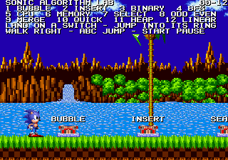
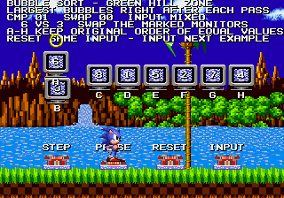

# Sonic Algorithm Lab

I turned twelve algorithms into playable rooms inside a Mega Drive / Genesis game.
Move Sonic through a Green Hill hub, enter an algorithm room, and land on
pressure switches to step, run, reset, or change its input.

The algorithms execute in Motorola 68000 assembly inside the ROM. Numbered
monitors represent data, ring markers identify the current operation, and the
HUD explains the live state. The original Sonic engine supplies movement,
collision, zone artwork, backgrounds, music, and the act-clear cash-register
**KACHING** when an algorithm finishes.

| Choose a room | Watch an exchange |
| --- | --- |
|  |  |

These are unedited emulator screenshots from a fresh controller-driven tour.
See the [full gallery](docs/GALLERY.md) for all twelve demonstrations and their
finished results.

## What is implemented

Version **0.6** contains twelve working demonstrations, each with five input
examples. The seven sorts use eight values with A–H identities that travel
with them, making the treatment of equal values visible.

| Hub label | Algorithm | Zone | What to watch |
| --- | --- | --- | --- |
| BUBBLE | Bubble sort | Green Hill | Adjacent comparisons, exchanges, and early exit. |
| INSERT | Insertion sort | Marble | A key moving left into a sorted prefix. |
| SEARCH | Binary search | Spring Yard | Low/high bounds, midpoint, and found/absent result. |
| BFS | Breadth-first search | Labyrinth | Queue, inspected edges, distances, and a shortest path. |
| CPU | Nonpreemptive priority scheduling | Star Light | Job selection, execution order, and waiting times. |
| MEMORY | First-fit allocation | Scrap Brain | Block scans, remaining capacity, and failed requests. |
| SELECT | Selection sort | Green Hill | Suffix minimum selection and placement. |
| ODDEVEN | Odd-even sort | Marble | Alternating even and odd adjacent pairs. |
| MERGE | Bottom-up merge sort | Spring Yard | Run widths, stable buffer writes, and merged segments. |
| QUICK | Quicksort | Labyrinth | Last-element pivots and Lomuto partitions. |
| HEAP | Heap sort | Star Light | Max-heap construction, sifting, and extraction. |
| LINEAR | Linear search | Scrap Brain | Left-to-right checks and the first match. |

For example, the default BFS input finds **A → C → F → H** in three edges.
The default binary search finds **6 at index 5** in two comparisons. CPU jobs
run in **D → B → A → C** order. These results are computed by the game; the
Python tools build and test it, and do not supply the answers during play.
The [native guide](native/README.md#algorithm-rules-and-examples) explains each
implementation, its counters, and the input cases.

## How to play

Open your built `Sonic Algorithm Lab - SAGE Engine.bin` in a Genesis emulator.
Use the **D-pad** to move, **A/B/C** to jump, and **Start** to pause or resume.
Keyboard mappings depend on your emulator.

1. In the hub, land on a labeled pressure switch, then jump through its ring.
   Move right to reach the later stations; jump over raised switches.
2. In a room, land on the controls below the monitors:

   | Switch | Action |
   | --- | --- |
   | STEP | Advance one algorithm operation. |
   | RUN / PAUSE | Toggle automatic stepping. An active operation finishes. |
   | RESET | Restore the selected example and clear its counters. |
   | INPUT | Select the next of five examples and reset. |

3. Jump off and land again to reactivate a switch. Follow the HUD and monitor
   identities as the algorithm advances.
4. On completion, the native act-results **KACHING** plays once. Jump over
   the switches to the right and enter the **HUB** ring to return.

Completion flags persist between rooms until a power cycle. The selected input
also persists between rooms, but entering a room starts that example afresh.

## Build locally

This checkout contains source, tools, documentation, and screenshots. Supply
your own exact **Sonic the Hedgehog 1 @ SAGE 2010** template; ROM files and
extracted game assets are not included. The required 2 MiB template SHA-256 is:

```text
952955f9a171636862f88bf6f64aa00a049abe5b8aaab7a8e63275bacdf445cd
```

Install Python 3 and put the Motorola 68000 assembler `vasmm68k_mot` on `PATH`.
From the repository root:

```sh
python3 native/tools/build.py --template '/path/to/Sonic SAGE 2010.bin'
```

The builder validates the template, extracts its required assets, assembles
the lab, and writes a new timestamped directory under `native/builds/`. The
printed path points to the playable ROM. Its neighbors include the assembly
listing, payload, source snapshot, and `BUILD_INFO.json` with all patch ranges
and hashes. Generated assets and builds are ignored by Git.

`SONIC_LAB_TEMPLATE` is also supported; an explicit `--template` takes
precedence. Run the tools without `-O` or `PYTHONOPTIMIZE`, since their checks
use assertions. See the [native build guide](native/README.md#rebuild) for
template selection and relocation details.

## How the project fits together

The builder patches a verified parent ROM and adds lab code/data in unused
space beginning at `$120000`. Native engine hooks load the flat rooms and
update the lab alongside Sonic's normal object processing. A switch requests
an operation; the algorithm state machine advances; monitors and the HUD
render that state. Python is not needed to play the resulting ROM.

| Source | Responsibility |
| --- | --- |
| [lab.asm](native/src/lab.asm) | Engine hooks, room routing, switches, rings, and monitors. |
| [algorithms.asm](native/src/algorithms.asm) | Bubble, insertion, binary search, BFS, priority scheduling, and first-fit. |
| [expanded.asm](native/src/expanded.asm) | Selection, odd-even, merge, quick, heap, and linear search. |
| [hud.asm](native/src/hud.asm), [ram.inc](native/src/ram.inc) | Live readouts and the lab's state layout. |
| [flat-zones.asm](native/src/flat-zones.asm) | Flat rooms built from the native terrain and collision data. |
| [native/tools](native/tools) | Asset extraction, building, independent algorithm references, and validation. |
| [headless.py](tools/headless.py) | Libretro frontend used to run the actual ROM for checks and captures. |
| [capture_gallery.py](tools/capture_gallery.py) | Reproducible controller-driven screenshot tour. |
| [SOURCE_LINEAGE.json](SOURCE_LINEAGE.json) | Exact source release and required ROM parent. |

## Verify and capture

Check a build's hashes, checksum, patch boundaries, source snapshot, and native
assets without an emulator:

```sh
python3 native/tools/validate.py '/path/to/build/Sonic Algorithm Lab - SAGE Engine.bin' \
  --template '/path/to/Sonic SAGE 2010.bin' \
  --static-only --out checks/static-1
```

For gameplay checks, install the optional Python dependency and provide a
libretro Genesis core:

```sh
python3 -m pip install -r requirements.txt
python3 native/tools/validate.py '/path/to/build/Sonic Algorithm Lab - SAGE Engine.bin' \
  --template '/path/to/Sonic SAGE 2010.bin' \
  --core '/path/to/genesis_plus_gx_libretro.so' --out checks/gameplay-1
```

Keep the ROM beside its `BUILD_INFO.json` and `source/` snapshot. Use a new
output directory for each check. To reproduce the screenshot tour:

```sh
python3 tools/capture_gallery.py '/path/to/build/Sonic Algorithm Lab - SAGE Engine.bin' \
  --core '/path/to/genesis_plus_gx_libretro.so' --out captures/tour-1
```

The published v0.6 ROM previously passed the complete suite on Genesis Plus GX
and BlastEm: 60 algorithm/input cases, twelve manual completions, 24 reload
checks, and 659 floor probes per core, plus a controller playthrough. For this
publication, the checkout was rebuilt to the same ROM and payload hashes and
statically checked. A fresh twelve-room screenshot tour captured that same game.
[Validation notes and reports](docs/VALIDATION.md) distinguish those runs.
Real hardware and human listening have not been tested.

## Credits and scope

I built this unofficial modification on a local copy of the Sonic the Hedgehog 1 @ SAGE 2010 template. I license my original contributions under the [MIT License](LICENSE), including
the algorithm implementations, engine integration, build tools, tests, and
documentation.

Sonic, the SAGE 2010 template, the base engine, and third-party artwork and
audio remain the property of their respective creators and rights holders.
Their existing terms also apply to game content visible in the screenshots.
