# Gameplay gallery

These 27 screenshots are native **320 × 224** emulator frames from one fresh
boot of the verified v0.6 ROM on Genesis Plus GX. The capture script used
controller inputs to visit and finish every room. It read RAM to steer Sonic
and check results; it did not write RAM, restore save states, or edit the images.

| Hub at the start | Later stations on the right | All twelve completed |
| --- | --- | --- |
| 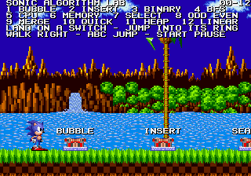 | 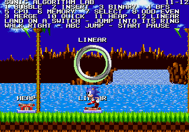 | 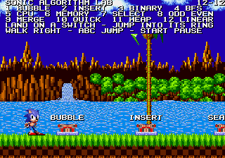 |

Each pair below shows an operation in progress and the completed default input.
The sorting monitors carry A–H identities with their original values.

| Demonstration | In progress | Completed |
| --- | --- | --- |
| Bubble sort · Green Hill | 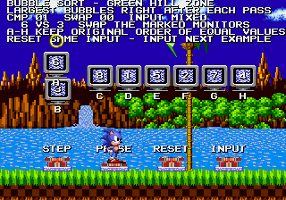 | 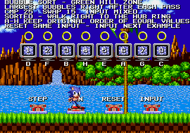 |
| Insertion sort · Marble | 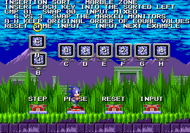 | 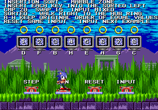 |
| Binary search · Spring Yard | 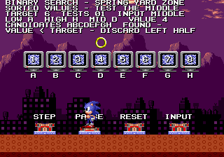 | 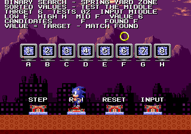 |
| Breadth-first search · Labyrinth | 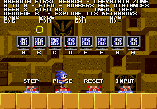 | 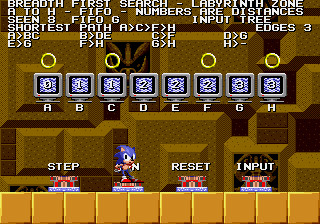 |
| Priority scheduling · Star Light | 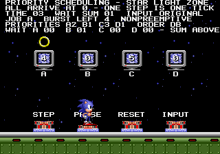 | 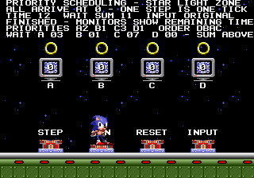 |
| First-fit allocation · Scrap Brain | 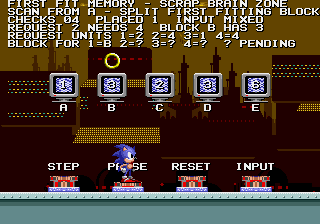 | 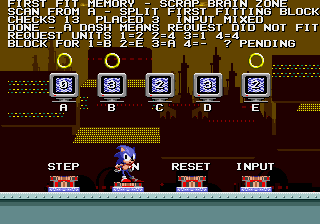 |
| Selection sort · Green Hill | 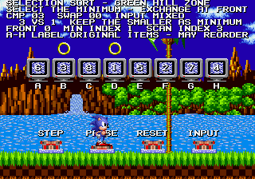 | 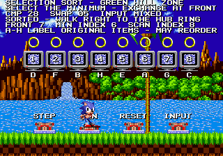 |
| Odd-even sort · Marble | 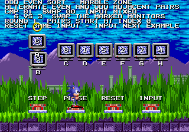 | 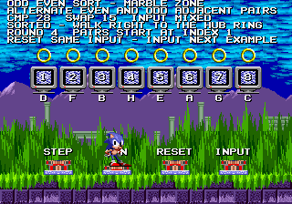 |
| Merge sort · Spring Yard | 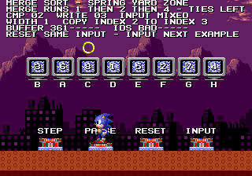 | 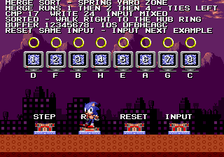 |
| Quicksort · Labyrinth | 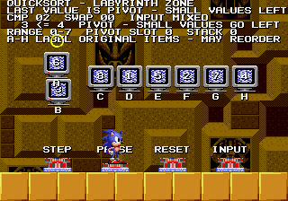 | 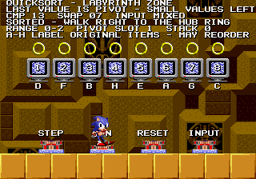 |
| Heap sort · Star Light | 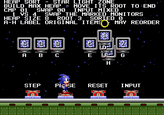 | 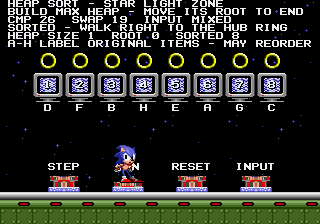 |
| Linear search · Scrap Brain | 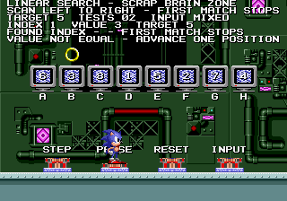 | 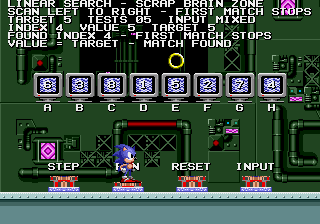 |

The [capture manifest](screenshots/manifest.json) records the ROM, core, and
script hashes, each frame number and image hash, and the algorithm state at
capture. The [capture script](../tools/capture_gallery.py) verifies each room's
initial and final state against the independent references, checks completion
sound ID `$C5`, and confirms all twelve completion flags on returning to the hub.

See the [README](../README.md#verify-and-capture) to reproduce the tour and the
[native guide](../native/README.md#algorithm-rules-and-examples) for the exact
algorithm rules behind each view.
